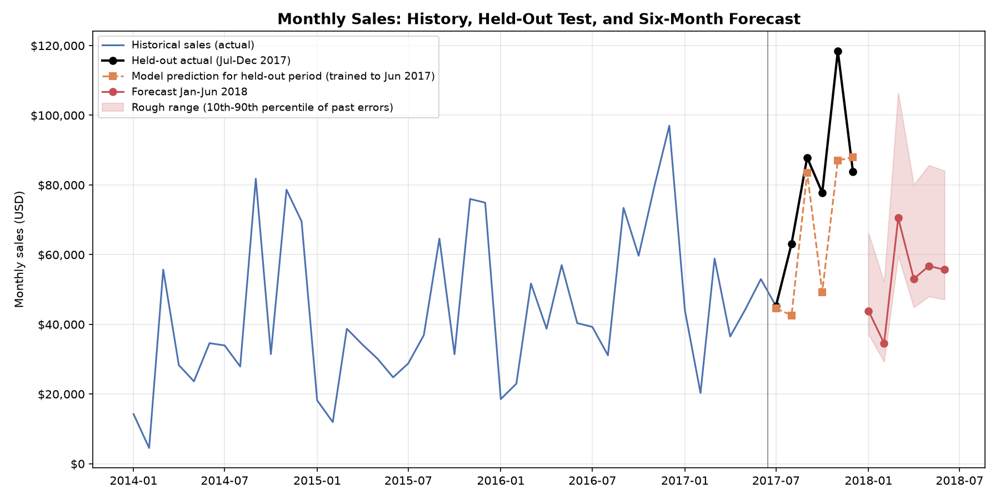

# Sales Performance and Forecasting Report

A Python analysis of four years of retail sales (Sample - Superstore dataset, Jan 2014 to Dec 2017) with a six-month sales forecast and a written business report.

This is a practice project on a sample dataset, not a real company. The currency is not stated in the file and is assumed to be USD. Because the data ends in December 2017, the January to June 2018 forecast is a practice exercise on historical data, not a live prediction.

## What is in this project

- Data cleaning with documented decisions
- Exploratory analysis: trends, seasonality, category, region, product and discount performance
- A six-month forecast tested on held-out data, with a rough uncertainty range
- A business report with findings and recommendations

**Not included:** an Excel or Google Sheets dashboard. The original plan included one, but this version is Python only.

## Key findings

- Total sales were \$2.30M and total profit \$286K (a 12.5% margin).
- Order lines discounted by more than 20% lost about \$135K combined. Lines with no discount earned a 29.5% margin. This is an association, not proof of cause.
- Furniture had a 2.5% margin against about 17% for Technology and Office Supplies.
- September, November and December had an above-average share of sales in all four years.
- The forecast for Jan to Jun 2018 is about \$314K (22% above the same months of 2017), with a wide range. A second model suggests about \$360K.

## Forecasting approach

Holt-Winters exponential smoothing (seasonal, no trend), chosen from four candidates using three rolling test windows. Training data always came before test data. Its average error across the windows was about 18% (MAPE). No model won every window. The same windows were used to choose the model and measure its accuracy, so that error is a best-case estimate.



## Project structure

```
data/raw/          original dataset (not included, see below)
data/processed/    cleaned and monthly datasets
notebooks/         analysis scripts (01 to 16) and sales_analysis.ipynb
outputs/figures/   charts
outputs/forecasts/ forecast table (CSV)
reports/           business report, cleaning log, data dictionary, project brief
requirements.txt   libraries needed
```

## How to reproduce

1. Download the Superstore dataset from Kaggle (check the license on the dataset page) and save it as `data/raw/Sample - Superstore.csv`. The file must contain Order Date, Sales and Profit columns.
2. Open the project folder in PyCharm and create a virtual environment with Python 3.14 (the project was built on 3.14.8).
3. Install the libraries listed in `requirements.txt`.
4. Run `notebooks/05_clean_data.py`, then `notebooks/06_monthly_table.py`.
5. Open `notebooks/sales_analysis.ipynb` and choose Restart kernel and run all cells.
6. Check your results: total sales should be \$2,297,200.86, total profit \$286,397.02, and distinct orders 5,009.

Scripts 01 to 04 are the inspection and quality checks that led to the cleaning decisions. Scripts 07 to 16 are the step-by-step versions of the analysis that appears in the notebook.

## Limitations

- Only 48 months of data and a small test set, so accuracy and ranges are approximate.
- A few very large orders can move a month by 25% or more, and the model cannot predict them.
- Superstore is a sample dataset, and the currency is not stated.
- The 12-month seasonal pattern is learned from four years only.

## Reports

- [Business report](reports/business_report.md)
- [Cleaning log](reports/cleaning_log.md)
- [Data dictionary](reports/data_dictionary.md)